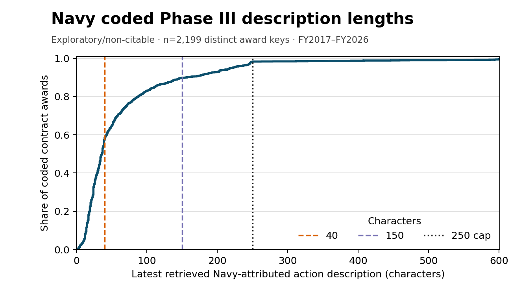
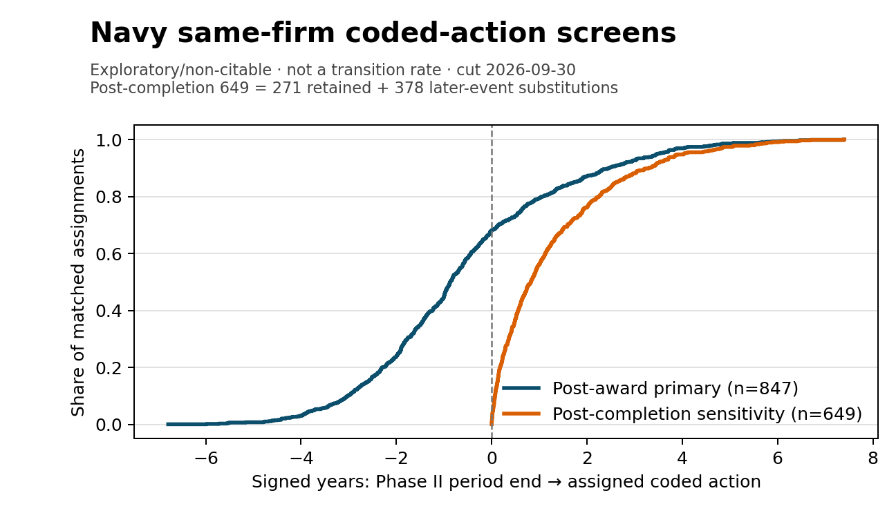

# Navy Phase III transition readout v1

**Prepared for:** SBA oversight and agency program-office analysts conducting internal method review.

**Answers for:** Section B2/B3 method review of whether public Navy-coded Phase III and SBIR.gov
records are adequate to design a hand-labeled validation study.

> **Exploratory — non-citable.** Prepared independently in a personal capacity; no agency
> affiliation. Descriptive only—no ranking, statutory undercount claim, causal interpretation,
> or recommendation.

**Frame.** SBIR.gov/FPDS through 2026-09-30; FY2017–FY2026.
“Navy” is SBIR.gov DoD/Navy or strict SR3/ST3 with awarding **or** funding sub-tier 1700.
Compound-key-deduplicated exact-UEI linkage is a same-firm screen, not a project-transition bound.
[Provenance and hashes](navy-transition-v1.summary.json) authenticate local inputs; untracked
snapshots prevent a clean-checkout rebuild.

## A — Coverage and description field

The cohort has 4,470 Phase I, 2,563 Phase II,
and 2,199 strict coded keys (1,918 DoN-awarded;
2,183 DoN-funded; 1,902 both).
1,819 first appear in-window; 380 predate it.

| FY | Phase I award date | Phase II award date | First coded action | Latest coded action |
|---:|---:|---:|---:|---:|
| FY2017 | 533 | 284 | 195 | 203 |
| FY2018 | 433 | 280 | 143 | 139 |
| FY2019 | 409 | 344 | 156 | 126 |
| FY2020 | 704 | 286 | 188 | 135 |
| FY2021 | 493 | 274 | 198 | 168 |
| FY2022 | 382 | 241 | 213 | 190 |
| FY2023 | 411 | 218 | 211 | 182 |
| FY2024 | 472 | 303 | 184 | 244 |
| FY2025 | 533 | 317 | 185 | 311 |
| FY2026 | 100 | 16 | 146 | 501 |

The SBIR.gov bulk export contains 100 Phase I and
16 Phase II records dated FY2026.
No source-completeness test supports year-over-year trend interpretation, especially for the latest
fiscal year.

Latest-action descriptions: median 36 characters; ≥40,
939/2,199 (42.7%); ≥150,
225/2,199 (10.2%);
1,718 representatives are nonzero modifications.
FPDS [requires the field and caps newly entered text at 250 characters after 2019-06-28](https://www.fsd.gov/gsafsd_sp/en/fpds-help-data-dictionary-v1-5?id=kb_article_view&sys_kb_id=ddfe622ecf894350d1eaf2c42f851c3c);
9 of
9 later representatives above 250
trace to pre-cap contracts. Thus 900 is cross-vintage-incomparable—not a zero or §638 standard.

The **historical, unreproduced** DoD comparator (n=6,351) reported 53.6% ≥40
and 88.5% <150. Legacy notes disagree on median 42 versus
[43](../../specs/phase3-match-benchmark/mse-dark-phase3.md); no committed generator reproduces or
method-matches it to Navy.

## B — Phase II award-to-coded-signal assignments

The primary **post-award screen** selects the earliest qualifying coded action after each Phase II
award date. Of 2,247 completed Phase II awards (834 firms),
847 (37.7%) map to
317 coded contracts across
160 firms. 168 contracts
cover 698 assignments (maximum reuse,
41). The other
1,400 lack a signal by the cut; this does not establish no transition.

Signed quantiles are assignment-weighted/event-conditional: 576
pre-completion, 271 on/after. No survival estimator is fitted.
The earliest-action rule lets an in-performance action shadow later candidates.
Of the 576 pre-completion assignments,
378 also have a later qualifying
post-completion signal (65.6%);
198 do not. The sensitivity's
649 matches consist of the
271 primary assignments already on/after completion plus
those 378 later candidates.

| Screen | Eligible action starts | Matched awards | Rate | Distinct contracts | Matched firms | No signal |
|:---|:---|---:|---:|---:|---:|---:|
| Post-award primary | Phase II award date | 847 | 37.7% | 317 | 160 | 1,400 |
| Post-completion sensitivity | Phase II period end | 649 | 28.9% | 281 | 137 | 1,598 |

Neither screen identifies a project transition or statutory Phase III rate. The post-completion
sensitivity changes the temporal eligibility rule; it does not validate the same-firm matches.

**Post-award signed latency**

| p10 | p20 | p30 | p40 | p50 | p60 | p70 | p80 | p90 |
|---:|---:|---:|---:|---:|---:|---:|---:|---:|
| -1,103 (-3.02) | -837 (-2.29) | -645 (-1.77) | -453 (-1.24) | -318 (-0.87) | -160 (-0.44) | 51 (0.14) | 388 (1.06) | 897 (2.46) |

**Post-completion sensitivity latency**

| p10 | p20 | p30 | p40 | p50 | p60 | p70 | p80 | p90 |
|---:|---:|---:|---:|---:|---:|---:|---:|---:|
| 26 (0.07) | 65 (0.18) | 132 (0.36) | 204 (0.56) | 300 (0.82) | 412 (1.13) | 582 (1.59) | 822 (2.25) | 1,202 (3.29) |

*Cells: days (years) from Phase II period end. The post-award screen has
n=847 assignments and permits negative values. The
post-completion sensitivity has n=649 assignments
and requires nonnegative values.*

| A. Description ECDF with FPDS cap | B. Conditional signed-latency ECDF |
|:---:|:---:|
|  |  |

## C — Description emptiness versus NAICS/PSC missingness

n=2,199: blank description=0, missing
NAICS=1, missing PSC=0. Correlation was not estimable because at least one binary input was constant; Panel C is therefore blocked rather than replaced with a different outcome.
Because FPDS requires description, zero blankness mainly reflects source validation—not narrative
richness or an optionality mechanism.

## D — Recent external capital/acquisition signals

Among 1,636 normalized Navy firms, the available Form D snapshot contains
46 firms with positive non-combination filings in
2024-11-16–2026-11-15
(42 high-confidence;
4 medium). This is filing participation—not
verified capital or SBIR attribution. EFTS lacks acquisition-specific dates, blocking that branch
and the union. No names are emitted. The window above is stated through 2026-11-15, but the snapshots do not reach it: Form D (latest 2026-08-20); EFTS (latest 2026-08-21). The uncovered tail is not captured in the count.

## Quality audit and published context

**Infrastructure finding.** The 900-character value had leaked into shared benchmark diagnostics,
not the FPDS parser, which preserves source text. This revision centralizes the official required/250
constraint, rejects larger benchmark thresholds, and removes unqualified “lower-bound” and
Kaplan–Meier-ready metadata. The defect was in research-evaluation semantics, not core ingestion.

- [GAO-25-107942](https://files.gao.gov/reports/GAO-25-107942/index.html) and
  [NASEM 2026](https://www.nationalacademies.org/read/29329/chapter/9) find Phase III tracking
  incomplete; this supports the coverage caution, not a Navy estimate.
- The closest Navy study, [Rovito, Kamp, and Etemadi (2025)](https://doi.org/10.1007/s10961-024-10141-2),
  says Phase III receipt is not strongly predictive of broader commercialization. Its different
  linkage/prediction design still cannot validate this readout.
- An [NRC NIH assessment](https://www.nationalacademies.org/read/11964/chapter/6) says first sales can
  precede Phase II completion, making negative times plausible but not validating these matches. The
  event-only ECDF excludes censored follow-up and is not [Kaplan–Meier](https://doi.org/10.1080/01621459.1958.10501452).
- [NRC 2014](https://www.nationalacademies.org/read/18821/chapter/5) reports commercialization
  near 45–50%, which is not comparable to this signal rate. [Howell (2017)](https://www.aeaweb.org/articles?id=10.1257/aer.20150808)
  supports finance as an outcome; [SEC methodology](https://www.sec.gov/files/dera-white-paper_regulation-d_082018.pdf)
  shows Form D is incomplete and self-reported, with no Navy-SBIR attribution here.

**Bottom line.** The results are a locally regenerable map of observed public signals, not a complete
commercialization measure. Coding and identity misses can bias downward; unrelated same-firm matches,
contract reuse, modifications, and name matching can bias upward. Nothing here identifies a mechanism.
